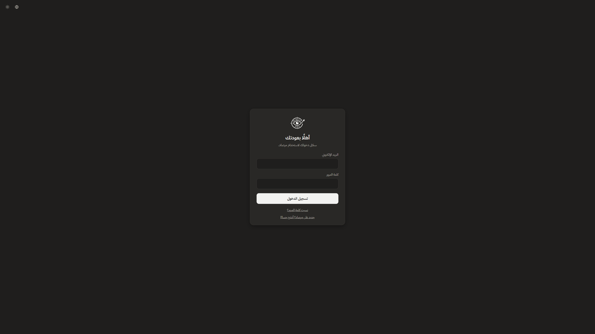
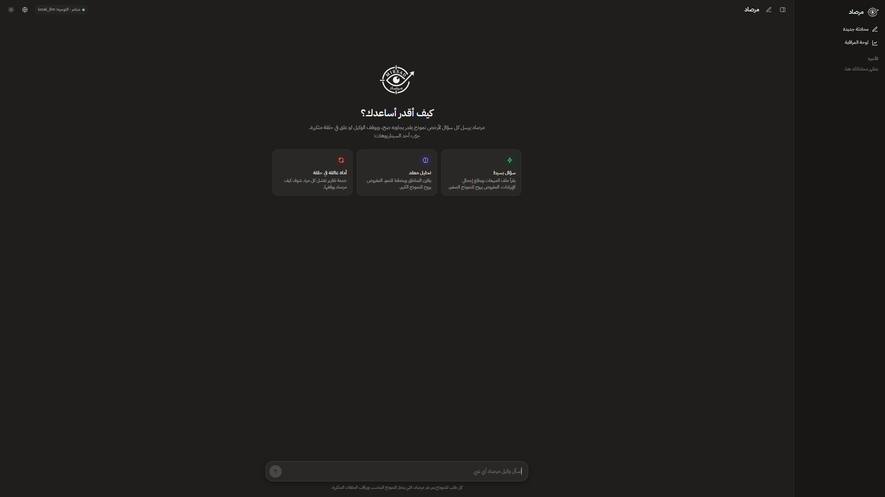
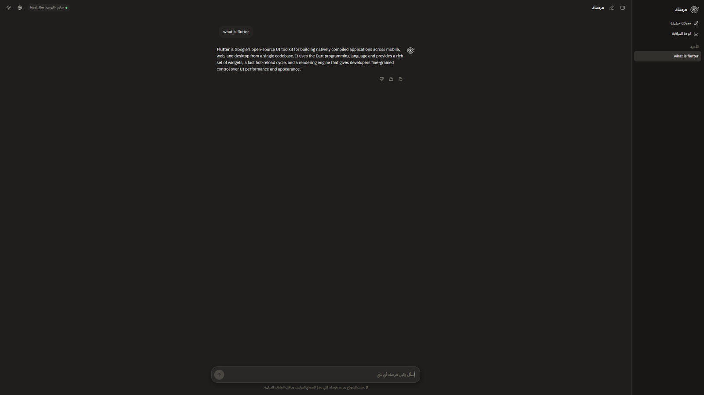
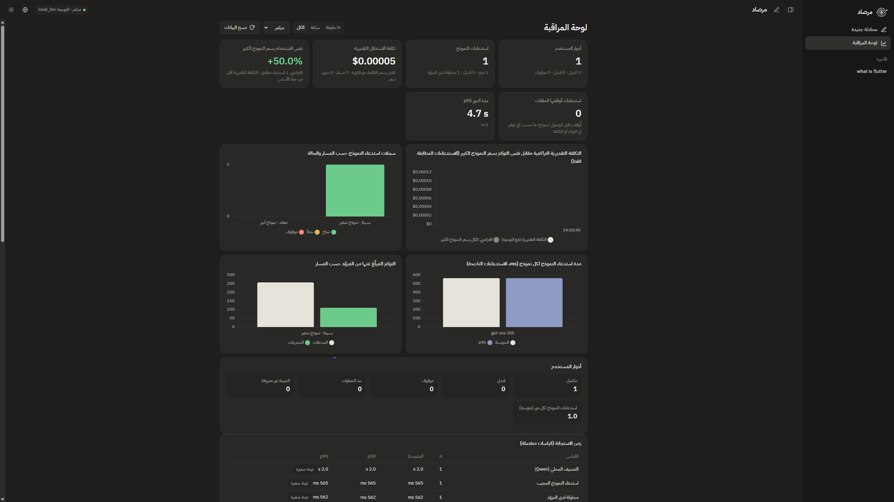
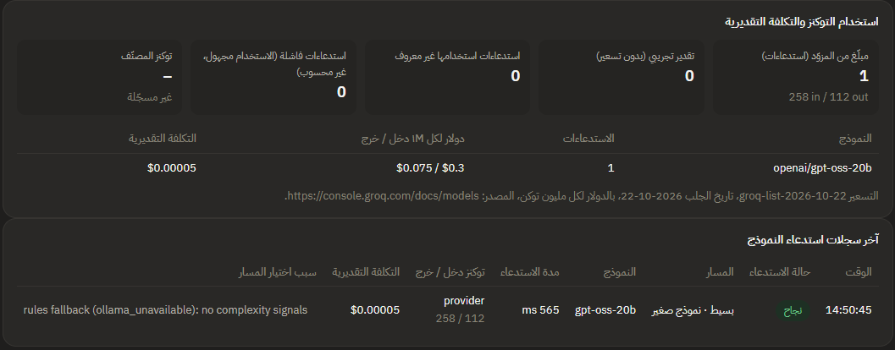
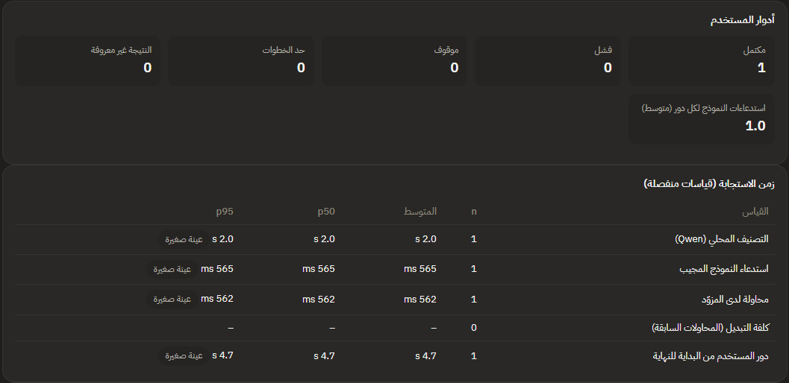
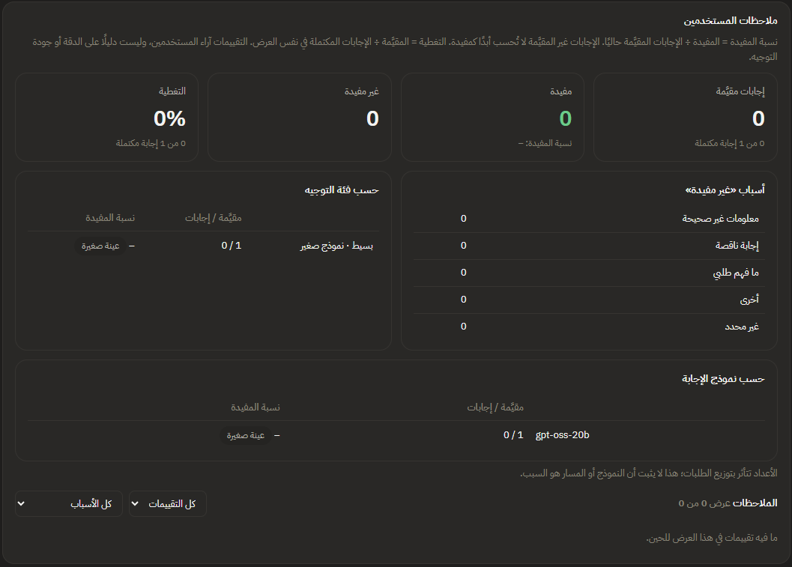

<div align="center">

<picture>
  <source media="(prefers-color-scheme: dark)" srcset="ui/web/logo-dark.png">
  
</picture>

# Mirsad | مرصاد

### Route smartly. Stop loops. See everything.

A proxy between an AI agent and its model provider that **routes** each task to a small or big model, **stops** agents that repeat a failing tool call, and **records** every call so admins can monitor cost estimates, errors, speed and user feedback.


</div>

<!-- No demo video or hosted app exists yet. Add the links here once they are real. -->

---

<details>
<summary><b>📑 Table of contents</b></summary>

- [📖 The Story](#story)
- [✨ Features](#features)
- [🧩 Design & Details](#design)
- [📸 Screenshots](#screenshots)
- [🛠️ Tech Stack](#tech-stack)
- [📁 Project Structure](#project-structure)
- [🚀 Running Mirsad](#running)
- [🧪 Evaluation and Limitations](#evaluation)

</details>

---

<a id="story"></a>
## 📖 The Story

AI agents call a language model again after every tool result. That makes them easy to build and hard to operate: a simple question can be sent to an expensive model, a tool that keeps failing can be retried until it burns through quota, and nobody can tell afterwards what happened, what it cost, or whether users were happy with the answers.

**Mirsad** (مرصاد, "observation post") sits in the middle. The agent believes it is talking to an OpenAI-compatible endpoint; every request actually goes through Mirsad first.

1. A **small local model** (Qwen through Ollama) reads each user message once and decides whether it is `simple` or `complex`. It only classifies; it never answers.
2. Mirsad sends simple tasks to an economical Groq model and complex tasks to a stronger one.
3. A **loop guard** refuses a tool call that has already failed three times with identical input.
4. Every call is **recorded**, and signed-in admins get a monitoring dashboard. Ordinary users only see a clean chat.

> Costs shown in Mirsad are **estimates** at Groq's public list prices from provider-reported token counts. They are not invoices (the free tier is not billed), and the comparison against the big model is **hypothetical**. See [Evaluation and Limitations](#evaluation).

---

<a id="features"></a>
## ✨ Features

| Feature | Description |
|---|---|
| **Per-turn routing** | A local Qwen classifier picks `simple` or `complex` once per user message; later tool steps of that turn reuse the decision. |
| **Routing fallback** | If Ollama is down or slow, Mirsad falls back to keyword rules and records why. Modes: `rules`, `shadow`, `local_llm`. |
| **Loop guard** | The same tool call failing 3 times with the same input is rejected with HTTP 429 before any model is called. |
| **Bounded credential failover** | A Groq 401 moves to the next backup key; a 429 never rotates keys. Attempts per request are capped. |
| **Live and mock modes** | `MIRSAD_MOCK=1` gives fake answers with real routing for offline work; it never silently replaces a live failure. |
| **Accounts and roles** | Email + password sign-up, sign-in and password recovery through Supabase Auth; server-side sessions; admin role assigned only on the server. |
| **Private conversations** | Chats are stored per user and every read or write is scoped to the verified user. |
| **File-based answers** | The agent can list and read sample files; a **File used** label appears only when the tool result provably matches the file. |
| **Answer feedback** | Helpful / Not helpful with optional reason and comment, one current rating per user and answer. |
| **Admin monitoring** | Turns, model calls and provider attempts counted separately; token usage, estimated cost, latency measurements and feedback analytics. |
| **Arabic and English UI** | The web app supports both languages, right-to-left layout and light/dark themes. |

---

<a id="design"></a>
## 🧩 Design & Details

### Request pipeline

```
Browser (signed in) -> web server (port 8501) -> LangChain agent -> Mirsad proxy (port 8000, internal) -> Groq
        |                      |                                          |  \-> local Qwen classifier (Ollama)
        |                      \-> SQLite: users, conversations, feedback   \-> SQLite request log (owner = verified user)
        \-> Supabase Auth (email + password)
```

For each request the proxy runs these steps in order:

1. **Loop guard**: the same tool call has failed 3 times with the same input -> reject (HTTP 429), no model is called.
2. **Router**: the local classifier answers `simple` or `complex` once per user message; Mirsad picks the answering model.
3. **Answer**: the chosen Groq model replies (or a fake reply in mock mode).
4. **Log**: provider-reported tokens, durations, estimated cost and the routing reasons are saved to SQLite.

### Answering models and routing

| Role | Configured model | Groq list price, USD per 1M tokens (in / out) |
|---|---|---|
| Classifier (local, never answers) | `qwen3:4b-instruct-2507-q4_K_M` via Ollama | not billed (runs locally) |
| `SMALL_MODEL`, simple prompts | `groq/openai/gpt-oss-20b` | 0.075 / 0.30 |
| `BIG_MODEL`, complex prompts | `groq/openai/gpt-oss-120b` | 0.15 / 0.60 |

Prices were retrieved on 2026-10-22 from <https://console.groq.com/docs/models> and the per-model pages, and live in `config.MODEL_PRICES` with their sources. Parameter count is not a price signal: the previous small model (`qwen/qwen3.8-27b`, 0.80 / 4.00) cost more than the big one, so it was replaced after a bounded comparison (see [Evaluation](#evaluation)). Older records keep their original model name and are priced by it.

### Failure handling

- **Ollama down or slow**: keyword rules decide and the fallback reason is recorded.
- **Groq 401 (invalid key)**: the credential is disabled for this process and the next backup key is tried with the same model and messages.
- **Groq 429 (rate limit)**: keys are **not** rotated (limits are shared across the account). Mirsad waits once, up to `PROVIDER_RETRY_AFTER_MAX_S`, or returns a clear error.
- **Other provider errors (400, 403, 5xx, timeouts)**: no failover; a clear error is returned.
- The total number of provider calls per request is bounded by `PROVIDER_MAX_ATTEMPTS` (default 3), and Mirsad **never** falls back to mock answers when live inference fails.

### What the dashboard counts

Admins see **Dashboard**, which defaults to **Live** records (filters: Live / Mock / Legacy / All). Three things are counted separately:

| Unit | Meaning |
|---|---|
| **User turn** | One submitted message and its whole agent run; grouped by verified user and turn id. Outcome: completed, failed, blocked or step limit. |
| **Model call** | One request to the answering model (a turn with tool steps makes several). |
| **Provider attempt** | One HTTP call to Groq inside a model call (key failover or the single rate-limit retry). |

Other definitions:

- **Tokens** come only from Groq's usage block; missing usage stays *unknown* and is never turned into zero. Mock numbers are shown separately.
- **Estimated cost** = input tokens × input rate + output tokens × output rate, per model. Models without a price are excluded and counted.
- **Hypothetical comparison** re-prices the *same recorded tokens* at the big model's rates. It can be negative and does not prove real savings, because another model may use different tokens or tool calls.
- **Latency** is split into local classification, answering-model call, provider attempt and end-to-end turn, with percentiles (linear interpolation) and sample counts. Turn duration exists only for turns recorded after it was introduced.
- **Call status vs feedback**: a successful call does not prove a correct answer. User feedback is shown separately; Helpful % counts currently rated answers only.

The dashboard has a built-in help section with these definitions, the time basis and the limitations.

### Accounts and permissions

- Sign-up, sign-in and password recovery use **Supabase Auth**; Mirsad stores no passwords.
- The browser holds one opaque `HttpOnly`, `SameSite=Lax` cookie. Supabase tokens stay on the server, encrypted at rest; identity always comes from the server-side session.
- Changes require a CSRF token and a same-origin request. Sessions end after 12 h idle or 7 days.
- Every conversation, message and request record is owned by the verified user. Ordinary users see only the chat: no route, model, token or cost details.
- Monitoring, feedback analytics, the user list and data reset are **admin-only**, enforced on the server. Records without an owner are admin-only.
- The proxy accepts only the web server (shared `MIRSAD_INTERNAL_TOKEN`); a browser cannot call it or forge an owner.

### Answer feedback

Each completed answer has **Copy**, **Helpful** and **Not helpful** (optional reason and comment). Ratings can be changed or cleared and are restored when a conversation is reopened. Feedback is stored in its own table and is never sent to the model. Admins see Helpful %, coverage (rated ÷ completed answers), reasons and breakdowns by route and answering model, with sample sizes. Ratings are opinions, not proof of accuracy.

---

<a id="screenshots"></a>
## 📸 Screenshots

Real captures of the running app, shown here in its Arabic interface (English is also supported) with the dark theme. Personal details were masked or cropped out.

<div align="center">

### 🔐 Authentication

<table>
  <tr>
    <th width="480" align="center" valign="middle">Login</th>
  </tr>
  <tr>
    <td align="center"></td>
  </tr>
</table>

<!-- Not captured yet (add these files, then move each table out of the comment):
<table>
  <tr>
    <th width="480" align="center" valign="middle">Sign Up</th>
    <th width="480" align="center" valign="middle">Password Recovery</th>
  </tr>
  <tr>
    <td align="center"></td>
    <td align="center"></td>
  </tr>
</table>
-->

### 💬 Chat

<table>
  <tr>
    <th width="480" align="center" valign="middle">Welcome</th>
    <th width="480" align="center" valign="middle">Conversation</th>
  </tr>
  <tr>
    <td align="center"></td>
    <td align="center"></td>
  </tr>
</table>

<!-- Not captured yet (add these files, then move each table out of the comment):
<table>
  <tr>
    <th width="480" align="center" valign="middle">File-based Answer</th>
    <th width="480" align="center" valign="middle">Answer Feedback</th>
  </tr>
  <tr>
    <td align="center"></td>
    <td align="center"></td>
  </tr>
</table>
-->

### 📊 Team Monitoring (admins only)

<table>
  <tr>
    <th width="480" align="center" valign="middle">Overview</th>
    <th width="480" align="center" valign="middle">Routing and Usage</th>
  </tr>
  <tr>
    <td align="center"></td>
    <td align="center"></td>
  </tr>
</table>

<table>
  <tr>
    <th width="480" align="center" valign="middle">Latency</th>
    <th width="480" align="center" valign="middle">User Feedback</th>
  </tr>
  <tr>
    <td align="center"></td>
    <td align="center"></td>
  </tr>
</table>

</div>

> The monitoring screenshots come from a test account with a single live request, so counts are tiny and feedback is empty. They show the layout, not typical numbers.

---

<a id="tech-stack"></a>
## 🛠️ Tech Stack

| Layer | Technology |
|---|---|
| Web server and proxy | FastAPI + Uvicorn |
| Agent | LangChain / LangGraph with `ChatOpenAI` pointed at the Mirsad proxy |
| Answering models | Groq via LiteLLM (`groq/openai/gpt-oss-20b`, `groq/openai/gpt-oss-120b`) |
| Local classifier | Qwen `qwen3:4b-instruct-2507-q4_K_M` through Ollama |
| Authentication | Supabase Auth (email + password), PyJWT, `cryptography` for encrypted server-side session tokens |
| Storage | SQLite (users, conversations, feedback, request log, provider attempts, turns) |
| Metrics | pandas and NumPy |
| Frontend | Single-page HTML/JS (`ui/web/index.html`) with Chart.js, marked and DOMPurify; Arabic/English, light/dark |
| Tests | pytest (offline) |

Versions are pinned in `requirements.txt`. LiteLLM is pinned to 1.106.0 (1.82.7 and 1.82.8 were compromised on PyPI in March 2026).

---

<a id="project-structure"></a>
## 📁 Project Structure

<details>
<summary><b>Show folder structure</b></summary>

```
mirsad/
├── config.py                  # every setting, threshold and price (MODEL_PRICES with sources)
├── proxy/
│   ├── main.py                # the request pipeline (port 8000, internal)
│   ├── routing.py             # one routing decision per user message
│   ├── classifier.py          # local Qwen classifier (Ollama)
│   ├── router.py              # keyword rules: a routing mode and the fallback
│   ├── loop_guard.py          # repeated-failure detection
│   ├── provider.py            # Groq call with bounded attempts
│   ├── credentials.py         # API-key pool (aliases only are ever shown)
│   ├── cost.py                # estimated cost and the hypothetical baseline
│   ├── db.py                  # SQLite schema and additive migrations
│   ├── internal.py            # internal-token check for the proxy
│   └── mock.py                # fake model for MIRSAD_MOCK=1
├── agent/
│   ├── agent.py               # LangChain agent that talks to the proxy
│   └── tools.py               # list_files, read_file, calculator, fetch_report (always fails)
├── auth/                      # Supabase client, server sessions, roles, chat storage, answer feedback
├── monitoring/
│   ├── metrics.py             # turns, calls, attempts, tokens, cost, latency, alerts
│   └── feedback.py            # admin feedback analytics
├── ui/
│   ├── web_server.py          # sign-in, chat, feedback, admin dashboard (port 8501)
│   ├── web/                   # index.html, logos, vendored JS libraries
│   └── app.py                 # retired Streamlit page (refuses to run)
├── scripts/manage_admin.py    # grant / revoke / list admins (server-side only)
├── eval/
│   ├── run_eval.py            # routing-rule and loop-guard evaluation
│   ├── answering_models.py    # bounded live comparison of answering models
│   └── *_prompts.csv          # hand-labelled routing prompts
├── tests/                     # offline pytest suite
├── data/files/                # sample files the agent may read
├── docs/diagrams.md           # flow diagrams (partly outdated, see Limitations)
├── .env.example               # configuration template (placeholders only)
└── requirements.txt
```

</details>

---

<a id="running"></a>
## 🚀 Running Mirsad

**Prerequisites:** Python 3.11+, [Ollama](https://ollama.com) installed and running, a [Supabase](https://supabase.com) project (for sign-in) and, for real answers, a free [Groq API key](https://console.groq.com/keys).

```bash
python -m venv venv && source venv/bin/activate      # Windows: venv\Scripts\activate
pip install -r requirements.txt
ollama pull qwen3:4b-instruct-2507-q4_K_M            # exact name; plain qwen3:4b will not work
cp .env.example .env                                  # Windows: copy .env.example .env
```

Edit `.env` (never commit it):

| Want | Set |
|---|---|
| Try without a Groq key | `MIRSAD_MOCK=1` (fake answers, routing still real) |
| Real answers | `MIRSAD_MOCK=0` and `GROQ_API_KEY=...` |
| Local classifier decides routing | `MIRSAD_ROUTING_MODE=local_llm` (`rules` and `shadow` are the alternatives) |

Start two terminals (venv active in both):

```bash
uvicorn proxy.main:app --port 8000           # 1: the proxy (internal: only the web server may call it)
uvicorn ui.web_server:app --port 8501        # 2: sign-in, chat and dashboard at http://localhost:8501
```

After **any** `.env` change, restart both servers. Without the Supabase and internal-secret settings the web server answers with a clear setup error; it never falls back to anonymous access. Signed in as an administrator, the status pill and dashboard show `classifier_status`: you want `ready`.

| Problem | Fix |
|---|---|
| `classifier_status` says `model not downloaded` | run the `ollama pull` line above |
| `classifier_status` says `unreachable` | start Ollama |
| `No module named 'mcp'` | `pip install mcp`, restart the proxy |
| Setup error page lists missing names | set those values in `.env` and restart both servers |

<details>
<summary><b>Detailed setup: Supabase, secrets and the first administrator</b></summary>

### `.env` values for sign-in (see `.env.example`)

| Variable | Meaning |
|---|---|
| `SUPABASE_URL`, `SUPABASE_PUBLISHABLE_KEY` | Supabase: Project Settings > API. The publishable key is enough; no service-role key is needed. |
| `MIRSAD_INTERNAL_TOKEN` | Long random secret shared by the web server and the proxy. |
| `MIRSAD_SESSION_SECRET` | Long random secret that encrypts stored session tokens. |
| `MIRSAD_PUBLIC_URL` | The address users open, e.g. `http://localhost:8501`; use `https://...` in production (cookies become `Secure`). |

Generate a secret with `python -c "import secrets; print(secrets.token_urlsafe(40))"`. Use a different value for each.

Optional keys: `GROQ_API_KEY_BACKUP_1..9` (tried only after a 401), `PROVIDER_MAX_ATTEMPTS`, `PROVIDER_RETRY_AFTER_MAX_S`, `MAX_TOKENS`, `LOOP_THRESHOLD`.

### Supabase dashboard settings (Authentication)

1. *URL Configuration* > **Site URL**: `http://localhost:8501` (your real HTTPS address in production).
2. *URL Configuration* > **Redirect URLs**: add `http://localhost:8501/auth/callback` (and the production equivalent). Use exact paths, not wildcards.
3. *Sign In / Providers* > **Email**: enabled, **Confirm email** on (recommended), minimum password length 8 or more.
4. *Emails*: the default templates work as they are. Optional hardening: change the link to `{{ .SiteURL }}/auth/callback#token_hash={{ .TokenHash }}&type=signup` (use `type=recovery` for the reset template); the page supports both shapes.
5. Email delivery: Supabase's built-in sender only mails **members of your Supabase organization** and allows about 2 messages per hour. For real users, configure a custom SMTP server.

Email-link tokens arrive in the URL *fragment* (`#...`), which browsers never send to servers, so they cannot appear in server logs. The page removes them from the address bar immediately and posts them to the server, which verifies them with Supabase.

### First administrator (internal admin access)

New accounts are always `user`. Admins are assigned only on the server machine:

1. Sign up, confirm the email, and sign in once (this creates your local user row).
2. Run `python -m scripts.manage_admin grant you@example.com`.
3. Reload the page; **Dashboard** now appears. Other commands: `list`, `revoke EMAIL` (the last admin cannot be revoked).

Nothing in the browser can grant this role. Keep the proxy bound to `127.0.0.1` (the default) and never expose port 8000.

### Try it (3 minutes)

1. Dashboard (admin): **Reset data**. (This deletes monitoring records for every user.)
2. Chat: send a simple question (should go to the small model).
3. Chat: send a design or coding task (should go to the big model).
4. Chat: ask for a report. `fetch_report` always fails, so Mirsad blocks the agent once the same call has failed 3 times.
5. Dashboard: compare turns, model calls and attempts, estimated cost, latency and the loop-blocked count.

</details>

---

<a id="evaluation"></a>
## 🧪 Evaluation and Limitations

```bash
pytest -q                  # offline, mock model, throwaway database
python -m eval.run_eval    # keyword rules and loop guard on hand-labelled prompts
```

| Check | Result | Notes |
|---|---|---|
| Offline test suite | 180 passed | Mock model and fake providers; no real inference or user data. |
| Routing accuracy, **keyword rules**, held-out set | 92.5% (37/40) | 3 complex prompts were sent to the small model. |
| Routing accuracy, **keyword rules**, dev set | 96.7% (58/60) | The rules were designed on this set. |
| Loop guard (offline replay) | 10/10 loops blocked, 0/6 false alarms | Replay through the real guard; the 6 controls are healthy retries. |
| Answering-model comparison (live) | 6/6 cases passed for `gpt-oss-20b` and for the replaced `qwen3.8-27b` | 12 agent runs, 19 provider calls, estimated cost about $0.0004 vs $0.0047. One case initially failed because of a bug in the checker (a curly apostrophe), fixed and re-scored without new calls. |

**What these numbers do not show**

- The Qwen **classifier** is not covered by the routing accuracy above; its only evaluation is preliminary and used examples written by an AI, so no accuracy figure is claimed for it.
- The model comparison had one run per case and two Arabic cases. It shows the new small model was adequate on those tasks, not that quality is equal in general. Hard or long Arabic, long tool chains and output truncation were not tested.
- Cost figures are estimates at list price, the big-model comparison is hypothetical, and no real savings are claimed. Savings depend on your own traffic.
- Mirsad has not been assessed for production use.

**Known limitations**

- One server process only: sessions, rate limits, the loop guard and the routing cache live in memory and reset on restart; storage is SQLite on one machine.
- The loop guard only catches repeats with identical input.
- The local classifier can be wrong and adds roughly 1-3 s per user message.
- No streaming responses.
- Groq's free tier allows roughly 30 requests per minute for the whole account.
- Deleting a conversation removes its messages but keeps usage records (they are cost history).
- Chats saved in a browser by the retired Streamlit page are not imported.
- `docs/diagrams.md` still describes the older Streamlit-based flow.
- Older records lack some measurements (turn duration, exact model-call duration, provider-reported tokens for early rows); the dashboard excludes or marks them instead of guessing.
