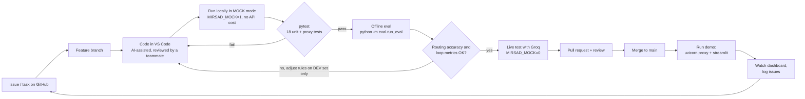
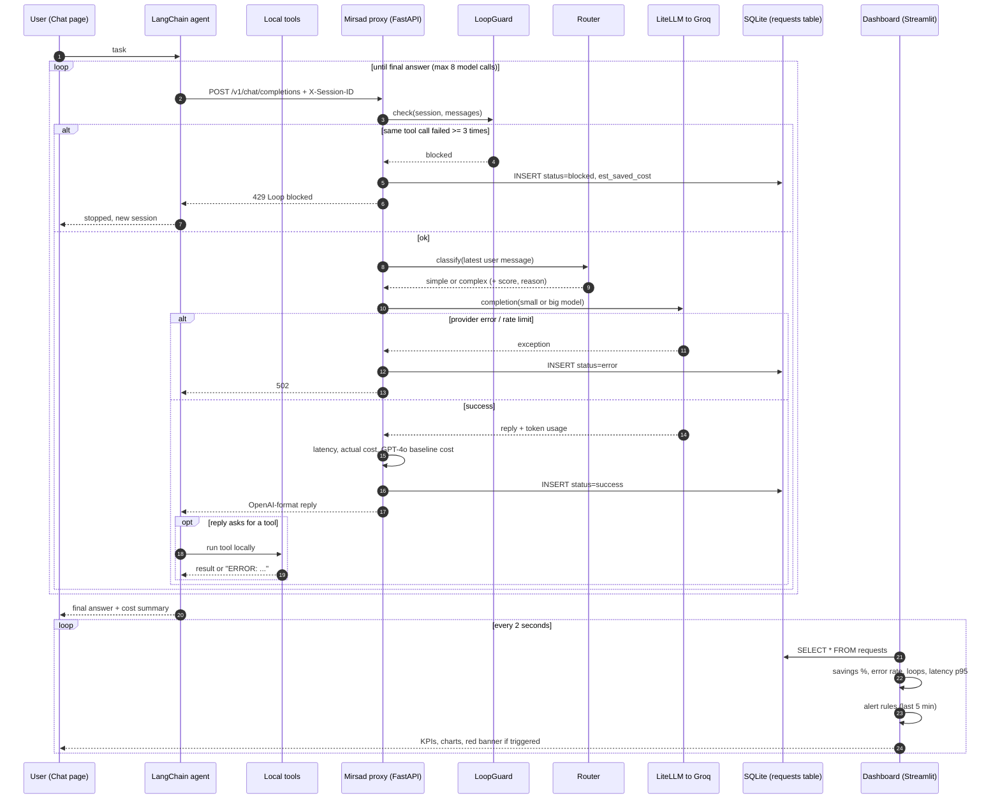

# Technical diagrams

Both diagrams describe the code in this repository. GitHub renders Mermaid
automatically; you can also paste them into https://mermaid.live to export PNG/SVG.

## 1. Development flow

## 2. Monitoring flow (one agent request)

### Where each metric is calculated

| Metric | Type (brief) | Source column(s) | Code |
|---|---|---|---|
| Requests, error rate | Application | `status` | `monitoring/metrics.py::summarize` |
| Loops blocked | Application | `status = blocked` | same |
| Avg / p95 latency per model | Performance | `latency_ms`, `model` | `ui/app.py` latency chart |
| Route mix, routing accuracy | AI quality | `route`; offline eval set | `eval/run_eval.py` |
| Tokens, actual vs baseline cost, savings % | Cost | `input_tokens`, `output_tokens`, `actual_cost`, `baseline_cost` | `proxy/cost.py` |
| Estimated loop savings | Cost | `est_saved_cost` | `proxy/main.py` (blocked branch) |
| Red alert | Alerting | last 5 min of rows | `monitoring/metrics.py::alerts` |
